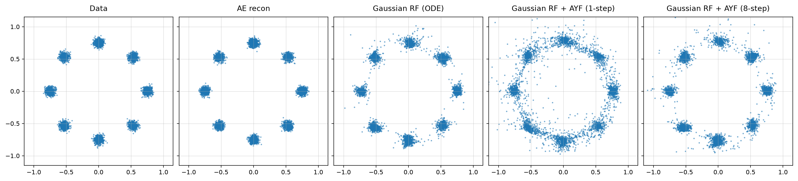
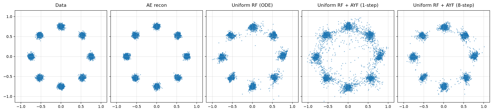
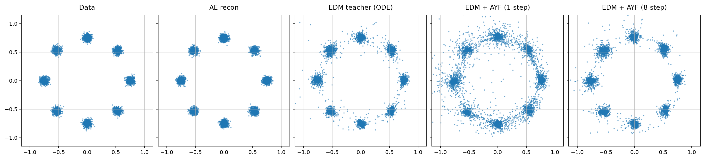

# UniFlow

Diffusion and flow models predominantly use Gaussian noise, which requires rescaling the latents to match its fixed unit scale.

This repo studies an alternative: uniform noise on [-1, 1] paired with tanh-bounded latents (a tanh applied to the encoder output). The supports coincide by construction, so there's nothing to rescale, and the bounded space can be enforced at generation time.

The study uses 1-Rectified Flow (RF) and compares the standard Gaussian noise baseline against the uniform noise variant, with an EDM baseline included for reference. It also evaluates Align Your Flow (AYF) distillation, training an AYF student for each baseline.

---

The repository compares three matched toy pipelines:

| Arm | Data latent | Base distribution | Learned models |
|---|---|---|---|
| Gaussian RF | Standardized unbounded encoder output | $\mathcal N(0,I)$ | RF teacher + AYF student |
| Uniform RF | $\tanh(E(x)) \in (-1,1)^d$ | $\mathcal U([-1,1]^d)$ | RF teacher + AYF student |
| EDM | Standardized unbounded encoder output | Gaussian perturbations | EDM teacher + AYF student |

This is intentionally a controlled 2D benchmark. The autoencoder and network
width/depth are matched across all arms. Gaussian RF and EDM train the same
unbounded autoencoder for reconstruction only, followed by a fixed post-training
latent rescaling: the latents are centred and divided by a *single global
scalar*, following latent-diffusion practice, so the transform is a similarity
and the latent geometry reaches the generative model undistorted. Uniform RF
adds the encoder's final `tanh` and a weak
moment penalty (weight $10^{-3}$) that targets the mean and second moment of
$\mathcal U([-1,1])$; its latents are not post-training standardized.

## Method

For both RF arms, independently sampled endpoints are joined by

$$
z_t = (1-t)z_0 + t z_1, \qquad t \sim \mathcal U(0,1),
$$

and the teacher regresses the conditional velocity with

$$
\mathcal L_{\mathrm{RF}}
= \mathbb E\left[\left\|v_\phi(z_t,t)-(z_1-z_0)\right\|^2\right].
$$

The AYF student is an arbitrary-interval flow map,

$$
C_\theta(z,t,s)=z+(s-t)f_\theta(z,t,s),
$$

trained to remain constant when its source moves along a teacher trajectory:

$$
\mathcal L_{\mathrm{AYF}}
= \mathbb E\left[\left\|
\partial_t C_\theta + J_z C_\theta\,v_\phi
\right\|^2\right].
$$

Following AYF, the tangent is normalised by its own norm,
$\mathrm{d}f/\mathrm{d}t \mapsto (\mathrm{d}f/\mathrm{d}t)/(\lVert
\mathrm{d}f/\mathrm{d}t\rVert + 0.1)$, which bounds the influence of the rare
large tangents that destabilise map distillation.

At inference, the same map supports one-step generation with $C(z_0,0,1)$ or
few-step generation by composing adjacent intervals.

The EDM teacher retains its standard preconditioned denoising objective with the
published Karras noise distribution and schedule. AYF distils diffusion teachers
inside the flow-matching framework rather than in $\sigma$ space, so the trained
denoiser is exposed as a flow-matching velocity field through the change of
variables $\sigma(t)=(1-t)/t$:

$$
v(z_t,t)=\frac{D\!\left(z_t/t,\ \sigma(t)\right)-z_t}{1-t}.
$$

The shared AYF student, objective, interval schedule and samplers then drive it
unchanged, so all three arms run the same algorithm with the same boundary
$C_\theta(z,t,t)=z$ and differ only in their teacher and base distribution. The
velocity stays $O(1)$ across the whole interval, unlike the preconditioned
unit-scale state $y=z/\sqrt{\sigma^2+\sigma_{\mathrm{data}}^2}$ used
previously, in which the true velocity collapses as
$O((\sigma_{\mathrm{data}}/\sigma)^2)$ at the noise end while the teacher's
denoiser error does not.

## Benchmark setup

Three settings determine what this benchmark measures, and they are coupled.

### Latent dimension

`latent_dim = 2`, matching the data dimension. This is the only setting in
which the study's premise is testable: the latent is full-dimensional, so the
bounded arm's tanh latents and its `U([-1,1]^d)` base genuinely share a support.

Any larger value is an *expansion*. A 2D data manifold placed in a 32-cube
occupies zero volume of the support it nominally shares, so "the supports
coincide" stops meaning anything; measured participation dimension stays at 2.0
however many dimensions are supplied. Expansion also flatters every arm: the
spare directions are ones the decoder was never trained to move along, so it
contracts student error that points into them, and one-step samples look
better than the flow map actually is.

### Autoencoder latent regularizer

`latent_reg_weight = 0` for the uniform arm. At `latent_dim = 2` the moment
penalty changes one-step results by less than the seed spread, so all three arms
now train their autoencoder on reconstruction alone and the comparison is
controlled.

It is **not** optional at larger `latent_dim`. Without it the encoder collapses
coordinates (`E[z^2]` falls to ~0.09 against the uniform target of 1/3) and the
teacher itself fails, so raise it if you raise `latent_dim`.

### Fourier features

Each model consumes a fixed random Fourier encoding of its coordinate input:

    gamma(u) = [u, sin(2*pi*(u/s_in)B), cos(2*pi*(u/s_in)B)],   B ~ N(0, ff_scale^2)

`B` is drawn once at construction and frozen — a buffer, never trained, though it
is saved in the `state_dict` and varies with `--seed`. Its `ff_size` columns are
random *directions* in the input space; each projection contributes a `sin` and a
`cos`, so the encoding has width `in_dim + 2*ff_size`. The raw input is kept
alongside, so the smooth part of the target stays trivially representable.

A plain MLP on a low-dimensional coordinate input has strong spectral bias and
cannot represent sharp functions of it (Tancik et al., 2020). At `latent_dim = 2`
that is exactly the regime: the rectified-flow velocity is near-discontinuous at
the basin boundaries between modes, and without the encoding the teacher smooths
across them and strands mass between the modes — a ring of samples that survives
4096 Euler steps, so it is the learned field and not the integration.

Random directions rather than a `2^k` schedule: NeRF-style frequencies are
axis-aligned, which suits a 1-D input like time (`FourierTimeEmbedding`, used for
the time conditioning) but is biased for a 2-D latent whose basin boundaries run
at arbitrary angles.

Three independent sites, each `None` to disable:

| config field | encodes | notes |
|---|---|---|
| `ae_ff_scale` | the 2D input `x`, before the encoder | shapes the latent itself; substitutes for the moment regularizer |
| `teacher_ff_scale` | the teacher's state | for EDM this is the *preconditioned* input `c_in z`, unit scale at every sigma |
| `student_ff_scale` | the AYF student's state | differentiated through by the EMD/LMD tangent (`J_z C`) |

`ff_scale` sets the frequency bandwidth and is the sensitive knob — results
depend on it far more than on `ff_size`. Roughly one oscillation per unit input
at `ff_scale = 1`; too large and the sinusoids wrap between nearby points, which
is worse than disabling them.

`ff_input_scale` divides the input first, so one nominal `ff_scale` means the
same *effective* frequency in every arm: bounded latents sit near `sqrt(1/3)`
and standardized ones near 1, and without the division a shared value would
favour whichever arm its magnitude happened to suit.

Student-side features are safe on bounded latents, and alongside encoder-side
features. On unbounded latents *alone* they degrade one-step results sharply —
the sinusoids alias in the tails, where the samples that dominate the fidelity
metric live.

### Distillation objective

`train_mode` selects the AYF objective: `emd`, `lmd`, or `emd+lmd` (plus `ct`,
the teacher-free variant, in the uniform arm). `emd_weight` and `lmd_weight` set
the mix and only apply to the terms the mode enables.

Align Your Flow's ablation reports that "AYF-LMD significantly outperforms
AYF-EMD" on a 2D toy dataset, and that "the trend reverses on image datasets,
where AYF-EMD consistently yields better results". Both halves reproduce here:
at `latent_dim = 2` LMD is roughly thirty times better than EMD by one-step
target NLL, while on MNIST EMD produces clean digits. So the objective is
regime-dependent rather than one being universally correct, and the default is
deliberately left per-arm rather than unified.

EMD follows the published Algorithm 1: the tangent is taken under stopgrad'd
weights, the loss is applied to the slope `F` rather than the full map
`C = z + (s-t)F` (using `C` multiplies the gradient by `s-t` and suppresses the
short intervals that carry the flow-matching signal), and the tangent warmup
`r = min(0.99, iters/H)` scales only the `(s-t) dF/dt` term, so training begins
as pure flow matching and eases the map-consistency term in. `H` defaults to
2000 here rather than the paper's 10k, because these runs are 10k student steps
in total.

### Known deviations from the paper

Two deliberate gaps, both verified against the paper rather than assumed:

- **LMD is the Boffi et al. objective, not AYF-LMD.** AYF-LMD uses a stopgrad
  target; here gradients flow through the JVP and only the teacher velocity is
  detached. The paper states the Boffi form "was already stable in practice and
  did not introduce training instabilities" and that "both versions performed
  similarly", recommending AYF-LMD for training *efficiency* rather than
  quality. This also explains an asymmetry seen during development: the paper
  reports EMD needs the stopgrad and LMD does not.
- **The student is randomly initialized.** The paper initializes "the student
  model with pretrained flow matching or diffusion model weights, following
  prior work to speed up training". The teacher and student have different
  architectures here (three time embeddings versus one), so weights cannot be
  copied directly; the `r = 0` end of the tangent warmup partially substitutes
  by starting the objective as velocity distillation, but it is not equivalent.

Autoguidance and the guidance-weight conditioning `lambda` in Algorithm 1 are
also absent, which is immaterial here because this benchmark has no
classifier-free guidance.


## Results

The default 8-Gaussians benchmark uses 2-dimensional latents, 20k
AE steps, 10k teacher steps, 10k student steps, and batch size 64. Each seed
generates 5,000 evaluation samples and evaluates 2,048 uniformly sampled points
with three complementary density diagnostics: generated-sample NLL under the
known target density (fidelity), held-out target NLL under a generated-sample
KDE (coverage), and the fraction beyond a three-noise-scale tube around the
clean modes or arcs. Results are the mean ± sample standard deviation across
seeds; lower is better. Figures use seed 1 as a
qualitative example and contain the target data, AE reconstruction, teacher ODE
samples, and one- and eight-step students.

The previous SWD, exact-W2, and MMD tables were removed because a single
symmetric average did not reflect the visible two-moons geometry. Run the
benchmark to regenerate the release tables with separate fidelity and coverage
values. Evaluation tensors are saved as ignored `.pt` files alongside the JSON
metrics so future metric changes do not require retraining.

### Qualitative samples

The following panels are seed 1 examples from that archived benchmark run.

**Gaussian RF + AYF**



**Uniform RF + AYF (uniform noise + tanh latents)**



**EDM**



## Reproduce

Python 3.10 or newer is required.

```bash
python -m venv .venv
source .venv/bin/activate
pip install -r requirements.txt
python -m toy.run_all
```

The default command reruns the five-seed benchmark while keeping seed 1 as the
only qualitative figure. Its new `edm_ayf_*` outputs are deliberately separate
from the archived `edm_*` consistency-student outputs shown above. When CUDA is
available, the seed runs execute in parallel spawned processes; each worker
runs the three pipelines for its seed sequentially. By default, one worker is
used per seed. Limit GPU memory use with `--workers N`, or pass `--workers 1`
for sequential execution. CPU runs remain sequential.

To continue an interrupted run, reuse completed seed files with:

```bash
python -m toy.run_all --resume
```

Raw per-seed metrics are written to `results/seeds/`; the aggregate, including
all individual values and the sample standard deviation, is written to
`results/summary_8gaussians.json` and a Markdown table is written to
`results/summary_8gaussians.md`. A corresponding grouped bar chart with
per-seed points and sample-standard-deviation error bars is written to
`results/summary_8gaussians.png`. `--resume` reuses completed seed files.

To generate qualitative figures for every seed, rerun with:

```bash
python -m toy.run_all --plot-all-seeds
```

This writes filenames such as `gaussian_rf_8gaussians-seed-3.png`. Because the
toy benchmark does not save model checkpoints, `--resume` cannot generate a
missing figure from an already completed run.

For a quick pipeline check:

```bash
python -m toy.run_all --seed 1 --ae_steps 10 --teacher_steps 10 --student_steps 10
```

Set one shared autoencoder latent dimension across all three benchmark arms with:

```bash
python -m toy.run_all --latent_dim 8
```

Individual arms can be run with `python -m toy.gaussian_rf`,
`python -m toy.uniform_rf`, or `python -m toy.edm_baseline`.
All generated figures and JSON metrics are written to `results/`.

The `mnist/` directory contains optional Uniform RF/AYF and EDM extensions.
They are not part of the reported comparison and require `torchvision` plus a
separate, substantially longer training run.

## Repository layout

```text
core/rf/       shared RF teacher and ODE utilities
core/ayf/      Gaussian-prior AYF objective and sampling
core/ayf_rf/   uniform-prior, bounded-latent AYF objective and sampling
core/edm/      EDM teacher, flow-matching wrapper, and consistency reference
toy/           primary 2D benchmark and runner
mnist/         optional image-space extension
results/       generated figures and metric summaries
```

## Scope

This repository contains research code, not a production library. The removed
ImageNet prototype was never validated and is deliberately excluded from the
public release. Large datasets, checkpoints, and local runs are ignored by Git.
