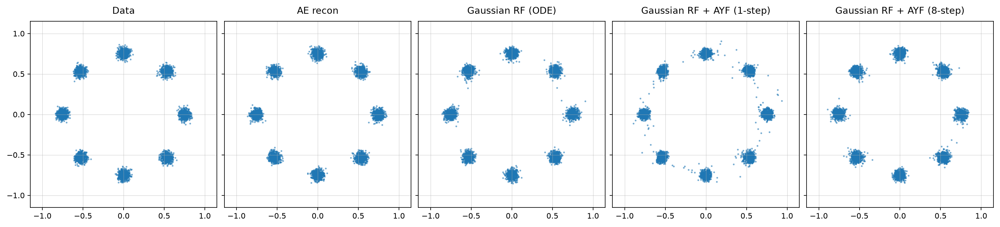
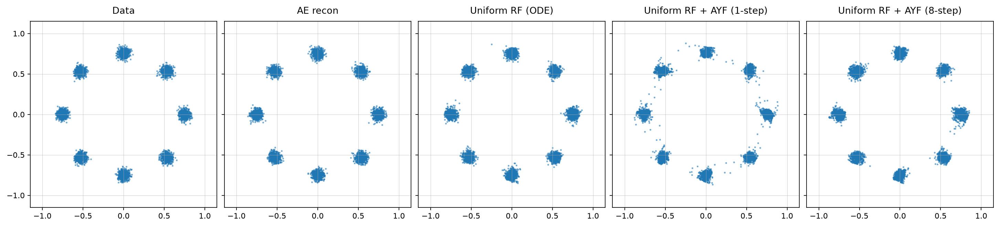
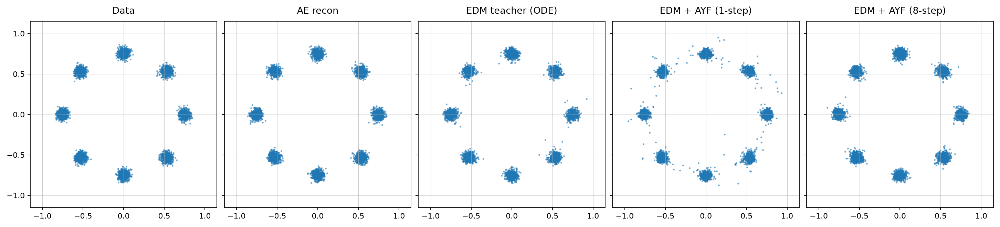

# UniFlow

Diffusion and flow models predominantly use Gaussian noise, which requires rescaling the latents to match its fixed unit scale.

This repo studies an alternative: uniform noise on [-1, 1] paired with tanh-bounded latents (a tanh applied to the encoder output). The latents lie inside the noise cube without post-training rescaling. This does not guarantee that the encoder covers the whole cube or that its latent density is uniform; the flow still has to learn that density.

The study uses 1-Rectified Flow (RF) and compares the standard Gaussian noise baseline against the uniform noise variant, with an EDM baseline included for reference. It also evaluates Align Your Flow (AYF) distillation, training an AYF student for each baseline.

---

The repository compares three matched toy pipelines:

| Arm | Data latent | Base distribution | Learned models |
|---|---|---|---|
| Gaussian RF | Standardized unbounded encoder output | $\mathcal N(0,I)$ | RF teacher + AYF student |
| Uniform RF | $\tanh(E(x)) \in (-1,1)^d$ | $\mathcal U([-1,1]^d)$ | RF teacher + AYF student |
| EDM | Standardized unbounded encoder output | Gaussian perturbations | EDM teacher + AYF student |

This is intentionally a controlled 2D benchmark. The autoencoder and network
width/depth are matched across all arms. Gaussian RF and EDM train the same
unbounded autoencoder for reconstruction only, followed by a fixed post-training
latent rescaling: the latents are centred and divided by a *single global
scalar*, following latent-diffusion practice, so the transform is a similarity
and the latent geometry reaches the generative model undistorted. Uniform RF
adds the encoder's final `tanh` and trains on reconstruction alone as well; its
latents need no post-training rescaling, because the `tanh` already places them
in the cube its base distribution occupies. All three arms therefore fit their
autoencoder to reconstruction and nothing else, which is what keeps the
comparison controlled.

## Method

For both RF arms, independently sampled endpoints are joined by

$$
z_t = (1-t)z_0 + t z_1, \qquad t \sim \mathcal U(0,1),
$$

and the teacher regresses the conditional velocity with

$$
\mathcal L_{\mathrm{RF}}
= \mathbb E\left[\left\|v_\phi(z_t,t)-(z_1-z_0)\right\|^2\right].
$$

The AYF student is an arbitrary-interval flow map,

$$
C_\theta(z,t,s)=z+(s-t)f_\theta(z,t,s),
$$

trained to remain constant when its source moves along a teacher trajectory:

$$
\mathcal L_{\mathrm{AYF}}
= \mathbb E\left[\left\|
\partial_t C_\theta + J_z C_\theta\,v_\phi
\right\|^2\right].
$$

Following AYF, the tangent is normalised by its own norm,
$\mathrm{d}f/\mathrm{d}t \mapsto (\mathrm{d}f/\mathrm{d}t)/(\lVert
\mathrm{d}f/\mathrm{d}t\rVert + 0.1)$, which bounds the influence of the rare
large tangents that destabilise map distillation.

At inference, the same map supports one-step generation with $C(z_0,0,1)$ or
few-step generation by composing adjacent intervals.

The EDM teacher retains its standard preconditioned denoising objective with the
published Karras noise distribution and schedule. AYF distils diffusion teachers
inside the flow-matching framework rather than in $\sigma$ space, so the trained
denoiser is exposed as a flow-matching velocity field through the change of
variables $\sigma(t)=(1-t)/t$:

$$
v(z_t,t)=\frac{D\!\left(z_t/t,\ \sigma(t)\right)-z_t}{1-t}.
$$

The shared AYF student, objective, interval schedule and samplers then drive it
unchanged, so all three arms run the same algorithm with the same boundary
$C_\theta(z,t,t)=z$ and differ only in their teacher and base distribution. The
velocity stays $O(1)$ across the whole interval, unlike the preconditioned
unit-scale state $y=z/\sqrt{\sigma^2+\sigma_{\mathrm{data}}^2}$ used
previously, in which the true velocity collapses as
$O((\sigma_{\mathrm{data}}/\sigma)^2)$ at the noise end while the teacher's
denoiser error does not.

## Benchmark setup

Three settings determine what this benchmark measures, and they are coupled.

### Latent dimension

`latent_dim = 2`, matching the data dimension. This avoids forcing the target
onto a lower-dimensional manifold. The bounded latents can be full-dimensional,
but equality with the support of `U([-1,1]^d)` also requires the encoder to cover
the cube; dimension preservation and `tanh` alone do not establish that.

Any larger value is an *expansion*. A 2D data manifold placed in a 32-cube
occupies zero volume of the support it nominally shares, so "the supports
coincide" stops meaning anything; measured participation dimension stays at 2.0
however many dimensions are supplied. Expansion also flatters every arm: the
spare directions are ones the decoder was never trained to move along, so it
contracts student error that points into them, and one-step samples look
better than the flow map actually is.

### Fourier features

Each model consumes a fixed random Fourier encoding of its coordinate input:

    gamma(u) = [u, sin(2*pi*(u/s_in)B), cos(2*pi*(u/s_in)B)],   B ~ N(0, ff_scale^2)

`B` is drawn once at construction and frozen — a buffer, never trained, though it
is saved in the `state_dict` and varies with `--seed`. Its `ff_size` columns are
random *directions* in the input space; each projection contributes a `sin` and a
`cos`, so the encoding has width `in_dim + 2*ff_size`. The raw input is kept
alongside, so the smooth part of the target stays trivially representable.

A plain MLP on a low-dimensional coordinate input has strong spectral bias and
cannot represent sharp functions of it (Tancik et al., 2020). At `latent_dim = 2`
that is exactly the regime: the rectified-flow velocity is near-discontinuous at
the basin boundaries between modes, and without the encoding the teacher smooths
across them and strands mass between the modes — a ring of samples that survives
4096 Euler steps, so it is the learned field and not the integration.

Random directions rather than a `2^k` schedule: NeRF-style frequencies are
axis-aligned, which suits a 1-D input like time (`FourierTimeEmbedding`, used for
the time conditioning) but is biased for a 2-D latent whose basin boundaries run
at arbitrary angles.

Three independent sites, each `None` to disable:

| config field | encodes | notes |
|---|---|---|
| `ae_ff_scale` | the 2D input `x`, before the encoder | shapes the latent itself |
| `teacher_ff_scale` | the teacher's state | for EDM this is the *preconditioned* input `c_in z`, unit scale at every sigma |
| `student_ff_scale` | the AYF student's state | differentiated through by the EMD/LMD tangent (`J_z C`) |

`ff_scale` sets the frequency bandwidth and is the sensitive knob — results
depend on it far more than on `ff_size`. Roughly one oscillation per unit input
at `ff_scale = 1`; too large and the sinusoids wrap between nearby points, which
is worse than disabling them.

`ff_input_scale` divides the input first, so one nominal `ff_scale` means the
same *effective* frequency in every arm: bounded latents sit near `sqrt(1/3)`
and standardized ones near 1, and without the division a shared value would
favour whichever arm its magnitude happened to suit.

Student-side features are safe on bounded latents, and alongside encoder-side
features. On unbounded latents *alone* they degrade one-step results sharply —
the sinusoids alias in the tails, where the samples that dominate the fidelity
metric live.

#### Ablating them

`--ff` takes a letter string naming the sites to enable — `A` encoder input,
`T` teacher state, `S` student state — and switches every site it does *not*
name off, so the string fully determines the configuration:

```bash
python -m toy.run_all --ff ATS       # all three (the default configuration)
python -m toy.run_all --ff AT        # no student-side features
python -m toy.run_all --ff A         # encoder input only
python -m toy.run_all --ff none      # no Fourier features anywhere
```

On `run_all` it applies uniformly to all three arms, which is what makes the
ablation controlled; the same flag works on each arm's own entry point. The
MNIST and CIFAR-10 arms have no encoder-input site, so there `--ff` accepts only
`T` and `S`.

`--ff` chooses the sites; `--ae-ff-scale` / `--teacher-ff-scale` /
`--student-ff-scale` set the frequency of a site (and a value of `0` also
disables one). The image arms leave all sites off by default, so `--ff` there
turns them on at the toy-calibrated scales in `DEFAULT_FF_SCALES`.

### CIFAR-10 autoencoder loss

All three CIFAR-10 arms train the AE with pixel MSE plus `0.1 * LPIPS`, using
frozen pretrained VGG features at the native 32×32 resolution. Install the
image dependencies with `pip install '.[cifar10]'`; the pretrained VGG weights
download on first use.

Set `--ae-lpips-weight` on `cifar10.run_all` or an individual arm to tune the
perceptual term; `0` restores MSE-only reconstruction without loading LPIPS.
The corresponding Config field is `ae_lpips_weight`. Training logs show MSE,
unweighted LPIPS, and total loss separately. MSE uses the raw decoder output;
LPIPS uses clamped reconstructions with both images scaled to `[-1, 1]`.

```bash
python -m cifar10.run_all --ae-lpips-weight 0.1
```

### ReFlow (off by default)

`reflow_rounds` refits the RF teacher on its own ODE coupling `(z0, ODE(z0))`
after the first fit, following Liu et al. 2022. 1-RF trains on *independent*
endpoint pairs, so the marginal paths cross and the learned velocity is an
average over those crossings -- curved, and poorly served by a single Euler
step. The ODE coupling does not cross by construction, so each round straightens
the field, which is what one-step sampling and AYF distillation want.

`0` is plain 1-RF and the default everywhere, so it does not affect any reported
number; `1` gives 2-RF, `2` gives 3-RF. Weights carry over between rounds rather
than being reinitialized, which is what makes a round cheap next to the first
fit. `reflow_steps` sets the steps per round, `reflow_pairs` the size of the
regenerated coupling, and `reflow_ode_steps` the integration accuracy used to
build it -- each round targets the *previous* ODE rather than the data, so a
coarse integration bakes its error into the teacher, and fidelity error
accumulates across rounds while straightness improves.

```bash
python -m toy.run_all --reflow-rounds 1 --reflow-steps 20000
```

The EDM arm trains a denoiser rather than an RF velocity, so it has no ReFlow
stage and both runners skip it there. Note the flag is spelled `--reflow-rounds`
on `run_all` and on the toy arms, but `--reflow_rounds` on the MNIST and
CIFAR-10 arms' own entry points.

### Distillation objective

`train_mode` selects the AYF objective: `emd`, `lmd`, or `emd+lmd` (plus `ct`,
the teacher-free variant, in the uniform arm). `emd_weight` and `lmd_weight` set
the mix and only apply to the terms the mode enables.

The uniform arm carries two further terms, both weight `0` by default and so
inert in everything reported here: `pairwise_anchor_weight` regresses the map
onto the sampled RF chord, `C(z_t,t,s) ~= (1-s)z0 + s z1`, and
`teacher_interval_anchor_weight` regresses it onto the integrated teacher,
`C(z_t,t,s) ~= Phi_teacher(t -> s)(z_t)`. The second integrates the teacher
every batch, so it is a debugging anchor rather than a training default.

Align Your Flow's ablation reports that "AYF-LMD significantly outperforms
AYF-EMD" on a 2D toy dataset, and that "the trend reverses on image datasets,
where AYF-EMD consistently yields better results". Both halves reproduce here:
at `latent_dim = 2` LMD is roughly thirty times better than EMD by one-step
target NLL, while on MNIST EMD produces clean digits. So the objective is
regime-dependent rather than one being universally correct, and the default is
deliberately left per-arm rather than unified.

EMD follows the published Algorithm 1: the tangent is taken under stopgrad'd
weights, the loss is applied to the slope `F` rather than the full map
`C = z + (s-t)F` (using `C` multiplies the gradient by `s-t` and suppresses the
short intervals that carry the flow-matching signal), and the tangent warmup
`r = min(0.99, iters/H)` scales only the `(s-t) dF/dt` term, so training begins
as pure flow matching and eases the map-consistency term in.

`H = 2000` in every arm, against the paper's 10000, and the measurement is what
picks it. The warmup anchors the student for an absolute number of steps rather
than a fraction of the run -- what matters is that the velocity model is usable
before the map-consistency term reaches full weight -- so the same value applies
whether an arm trains its student for 20k steps or 80k. A longer horizon buys
nothing once the flow map's time embedding is bounded: on the CIFAR-10 seed that
used to diverge, `H = 2000` reaches a one-step MSE of 0.0070 against the teacher
ODE and `H = 10000` reaches 0.0095, and setting both is no better than either
alone. The two are alternative fixes for the same instability, and the embedding
bound is the one that addresses its cause; see
[Time-embedding stiffness](#time-embedding-stiffness-in-the-flow-map-fixed).

### Known deviations from the paper

Two deliberate gaps, both verified against the paper rather than assumed:

- **LMD is the Boffi et al. objective, not AYF-LMD.** AYF-LMD uses a stopgrad
  target; here gradients flow through the JVP and only the teacher velocity is
  detached. The paper states the Boffi form "was already stable in practice and
  did not introduce training instabilities" and that "both versions performed
  similarly", recommending AYF-LMD for training *efficiency* rather than
  quality. This also explains an asymmetry seen during development: the paper
  reports EMD needs the stopgrad and LMD does not.
- **The student is randomly initialized.** The paper initializes "the student
  model with pretrained flow matching or diffusion model weights, following
  prior work to speed up training". The teacher and student have different
  architectures here (three time embeddings versus one), so weights cannot be
  copied directly; the `r = 0` end of the tangent warmup partially substitutes
  by starting the objective as velocity distillation, but it is not equivalent.

Autoguidance and the guidance-weight conditioning `lambda` in Algorithm 1 are
also absent, which is immaterial here because this benchmark has no
classifier-free guidance.

### Time-embedding stiffness in the flow map (fixed)

AYF stabilizes the EMD tangent by setting `c_noise(t) = t`, and identifies
`d_t F_theta` as the dominant source of instability in it. `FourierTimeEmbedding`
takes the equivalent precaution through its `deriv_cap`, but that knob caps the
time-derivative of *each* `sin`/`cos` pair rather than of the embedding as a
whole. Since

    ||d emb/dt||^2 = sum_i amp_i^2 * omega_i^2,

the aggregate is `deriv_cap * sqrt(num_frequencies)` — at the 64 frequencies
these models use, `||d emb/dt|| ~ 16` against `||emb|| ~ 0.5`.

That is harmless for a network the losses only *evaluate*, and fatal for one they
differentiate in `t`. The measured AYF tangent `dF/dt` was **99.8% `d_t F`** (the
transport term `J_z F . v` was ~0.038), so once the tangent warmup `r` reached its
cap the map-consistency term ran 1.5–3.4x the flow-matching term anchoring it and
`cos(g, fm)` fell from 0.999 to ~0.35. On the CIFAR-10 seed shipped here the
student blew up within 250 steps of the cap — `eval endpoint` 0.014 (step 1750) →
0.027 (2000) → **0.368** (2250) — and never recovered, ending as the identity
map: one-step MSE against the teacher ODE 0.224, versus 0.234 for
`C(z,0,1) = z`. It is seed-dependent, so some runs pass through untouched;
MNIST's saved student failed the same way.

`RFIntervalFlowMap` now scales its `deriv_cap` by `1/sqrt(num_freq)`, so the flow
map's time embedding obeys the nominal bound. On the same failing seed the
student reaches a one-step MSE of **0.0070** on CIFAR-10 (32x better) and
**0.0168** on MNIST (19x better), and both produce recognizable images in a
single step.

The fix is deliberately confined to the student. The teacher is only ever
evaluated inside the AYF losses — `v = teacher(z_t, t)` runs under `no_grad`, and
the JVP is taken through `student.slope` alone — so it is never differentiated in
`t` and gains nothing from a softer embedding. Softening it as well measurably
*costs* time resolution: on the 2D benchmark it moved teacher target NLL by
+0.09 (uniform) and +0.21 (Gaussian) nats. Note that `freqs` and `amp` are
registered buffers, so a teacher restored from a checkpoint keeps whatever
embedding it was trained with regardless of this setting.

The paper's own warmup horizon (`tangent_warmup_steps = 10000` rather than 2000)
fixes the same seed independently, to a one-step MSE of 0.0095. It is the weaker
of the two -- it delays the unbounded tangent rather than bounding it -- and
stacking it on top of the embedding fix gains nothing, so `H` stays at 2000; see
[Distillation objective](#distillation-objective).


## Results

The seed-1 uniform teacher's distorted blobs were investigated with controlled
sampling and learning-rate ablations. A low-LR finishing phase substantially
improves teacher and AYF fidelity; see the [diagnosis and reproduction commands](results/toy/8gaussians/uniform_rf/experiments/diagnosis_seed_1/REPORT.md).
The default now uses the matched schedule below (benchmark protocol v7).
The existing figures and metrics are historical v6 results, not measurements of
the new defaults; `--resume` will reject them and require fresh runs.

The default toy benchmark uses 2-dimensional latents, 40k AE steps, and batch
size 64. **Every teacher and AYF student**, including EDM, trains for 80k updates:
40k at `1e-3`, then 40k at `1e-4`. AdamW's state and student tangent warmup
continue across the rate drop. AE training remains at its existing 40k/`1e-3`
setting for all arms.

`--teacher-steps` and `--student-steps` specify total updates; the defaults do not
append a separate refinement phase. Short smoke runs therefore stay short.
All individual arms and `toy.run_all` accept `--teacher-lr`, `--teacher-final-lr`,
`--teacher-lr-drop-step` and the corresponding student flags. For example,
`--teacher-lr-drop-step -1` disables the teacher's rate drop. Optional uniform-arm
`--*-refine-steps` still explicitly adds a separate finishing phase.

Each seed generates 5,000 evaluation samples and evaluates 2,048
uniformly sampled points with three complementary density diagnostics:
generated-sample NLL under the known target density (fidelity), held-out target
NLL under a generated-sample KDE (coverage), and the fraction beyond a
three-noise-scale tube around the clean modes or arcs. Results are the mean ±
sample standard deviation across seeds; lower is better. Figures use seed 1 as a
qualitative example and contain the target data, AE reconstruction, teacher ODE
samples, and one- and eight-step students.

The previous SWD, exact-W2, and MMD tables were removed because a single
symmetric average did not reflect the visible two-moons geometry. Run the
benchmark to regenerate the release tables with separate fidelity and coverage
values. Evaluation tensors are saved as ignored `.pt` files alongside the JSON
metrics so future metric changes do not require retraining.

### Qualitative samples

The following panels are seed 1 examples from that archived benchmark run.

**Gaussian RF + AYF**



**Uniform RF + AYF (uniform noise + tanh latents)**



**EDM**



## Reproduce

Python 3.10 or newer is required.

```bash
python -m venv .venv
source .venv/bin/activate
pip install -r requirements.txt
python -m toy.run_all
```

The default command reruns the five-seed benchmark while keeping seed 1 as the
only qualitative figure. Its new `edm_ayf_*` outputs are deliberately separate
from the archived `edm_*` consistency-student outputs shown above. When CUDA is
available, the seed runs execute in parallel spawned processes; each worker
runs the three pipelines for its seed sequentially. By default, one worker is
used per seed. Limit GPU memory use with `--workers N`, or pass `--workers 1`
for sequential execution. CPU runs remain sequential.

To continue an interrupted run, reuse completed seed files with:

```bash
python -m toy.run_all --resume
```

Raw per-seed metrics are written to `results/toy/<dataset>/<baseline>/seed_<n>/metrics.json`; the aggregate, including
all individual values and the sample standard deviation, is written to
`results/toy/8gaussians/summary.json` and a Markdown table is written to
`results/toy/8gaussians/summary.md`. A corresponding grouped bar chart with
per-seed points and sample-standard-deviation error bars is written to
`results/toy/8gaussians/summary.png`. `--resume` reuses completed seed files.

To generate qualitative figures for every seed, rerun with:

```bash
python -m toy.run_all --plot-all-seeds
```

This writes figures such as `results/toy/8gaussians/gaussian_rf/seed_3/samples.png`.
Because the multi-arm runner does not save model checkpoints, `--resume` cannot generate a
missing figure from an already completed run.

For a quick pipeline check:

```bash
python -m toy.run_all --seed 1 --ae-steps 10 --teacher-steps 10 --student-steps 10
```

Set one shared autoencoder latent dimension across all three benchmark arms with:

```bash
python -m toy.run_all --latent-dim 8
```

Individual arms can be run with `python -m toy.gaussian_rf`,
`python -m toy.uniform_rf`, or `python -m toy.edm_baseline`.
All toy runs use the same layout, whether launched individually or through
`toy.run_all`:

```text
results/toy/<dataset>/
  summary.json / summary.md / summary.png
  <baseline>/
    seed_<n>/
      run_config.json
      metrics.json
      metrics.pt          # evaluation samples, not model weights
      samples.png
      samples_latent.png  # when latent_dim == 2
    experiments/         # named ablations and diagnostics
    legacy_default/      # older unsuffixed runs, kept separately
    archive/pre_init_fix/
```

Use `--out-dir <directory>` on an individual arm for a named experiment. Existing
`--out` filename overrides remain supported; metrics default to a sibling JSON.
The uniform arm also accepts `--checkpoint-out <path>` for model weights.
The legacy artifacts have been moved without overwriting existing files; the
move manifest is `results/toy/migration_manifest.json`. The idempotent migration
utility can preview any remaining legacy files with `python -m toy.migrate_results`
and move them with `--apply`. MNIST and CIFAR outputs are unchanged.

The `mnist/` and `cifar10/` directories contain optional Uniform RF/AYF and EDM
extensions to image space. They are not part of the reported comparison and
require `torchvision` plus a separate, substantially longer training run. Both
packages have the same three arms and the same CLI:

```bash
python -m mnist.run_all
python -m cifar10.run_all
```

`cifar10/` mirrors `mnist/` arm for arm, differing only where the dataset forces
it to: an 8x8 latent grid instead of 7x7 (so `--patch 2` is also legal there), a
wider autoencoder over 3-channel inputs, 8 latent planes rather than 4, and RGB
figure output. Unlike MNIST, unconditional CIFAR-10 FID is widely published, so
it is the arm where adding a quantitative image metric would give an external
reference point rather than only a within-repo ranking.

## Repository layout

```text
core/rf/       shared RF teacher and ODE utilities
core/ayf/      Gaussian-prior AYF objective and sampling
core/ayf_rf/   uniform-prior, bounded-latent AYF objective and sampling
core/edm/      EDM teacher, flow-matching wrapper, and consistency reference
toy/           primary 2D benchmark and runner
mnist/         optional image-space extension (28x28 grayscale)
cifar10/       optional image-space extension (32x32 RGB), mirrors mnist/
tests/         unit tests for the shared objectives and utilities
results/       generated figures and metric summaries
```

## Scope

This repository contains research code, not a production library. The removed
ImageNet prototype was never validated and is deliberately excluded from the
public release. Large datasets, checkpoints, and local runs are ignored by Git.
