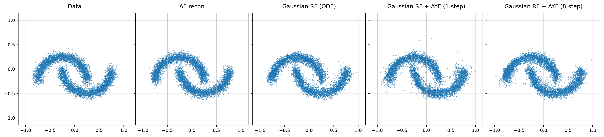
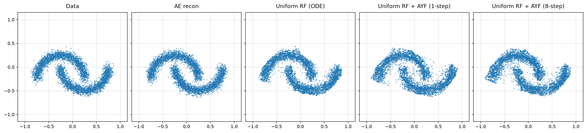
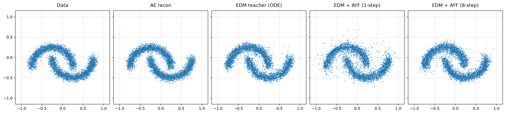
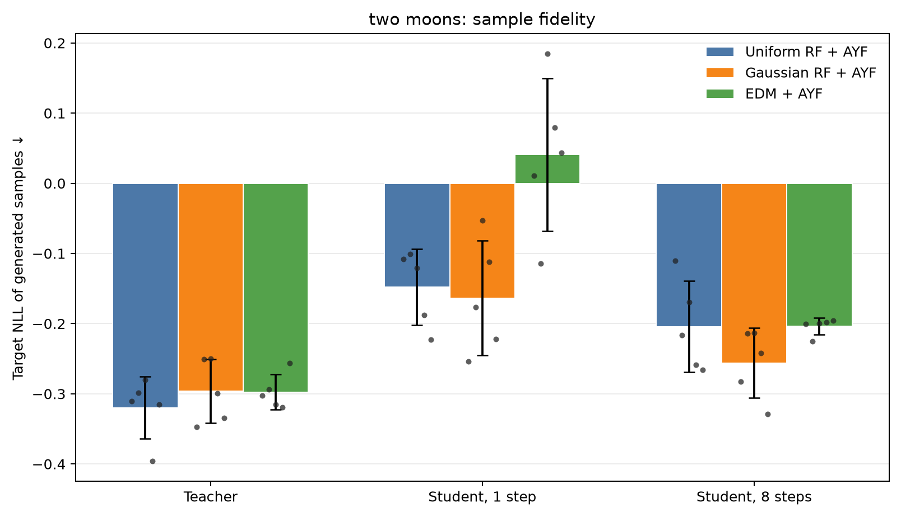

# UniFlow

Diffusion and flow models predominantly use Gaussian noise, which requires rescaling the latents to match its fixed unit scale. This can be limiting in settings where the latent representations are evolving (e.g., online learning), since it requires re-estimation of the scale which requires computing the latents over a significant data subset with the model frozen.

This repo studies an alternative: uniform noise on [-1, 1] paired with tanh-bounded latents (a tanh applied to the encoder output). The latent space is naturally aligned with the noise cube, avoiding the need for post-training rescaling.

The study uses 1-Rectified Flow (RF) and compares the standard Gaussian noise baseline against the uniform noise variant, with an EDM baseline included for reference. It also evaluates Align Your Flow (AYF) distillation, training an AYF student for each baseline.

This idea was used in my [Horizon Imagination](https://github.com/leor-c/horizon-imagination) paper in a complex visual RF world model. The paper and code provide further evidence for the performance of this approach at scale in a realistic online RL setting.

---

The repository compares three matched toy pipelines:

| Arm | Data latent | Base distribution | Learned models |
|---|---|---|---|
| Gaussian RF | Standardized unbounded encoder output | $\mathcal N(0,I)$ | RF teacher + AYF student |
| Uniform RF | $\tanh(E(x)) \in (-1,1)^d$ | $\mathcal U([-1,1]^d)$ | RF teacher + AYF student |
| EDM | Standardized unbounded encoder output | Gaussian perturbations | EDM teacher + AYF student |

This is a controlled 2D benchmark. The autoencoder and network
width/depth are matched across all arms. Gaussian RF and EDM train the same
unbounded autoencoder for reconstruction only, followed by a fixed post-training
latent rescaling: the latents are centred and divided by a *single global
scalar*, following latent-diffusion practice, so the transform is a similarity
and the latent geometry reaches the generative model undistorted. Uniform RF
adds the encoder's final `tanh` and trains on reconstruction alone as well; its
latents need no post-training rescaling, because the `tanh` already places them
in the cube its base distribution occupies.


## Roadmap

- [ ] Extend the experiments to CIFAR-10 (in-progress)

## Method

For both RF arms, independently sampled endpoints are joined by

$$
z_t = (1-t)z_0 + t z_1, \qquad t \sim \mathcal U(0,1),
$$

and the teacher regresses the conditional velocity with

$$
\mathcal L_{\mathrm{RF}}
= \mathbb E\left[\left\|v_\phi(z_t,t)-(z_1-z_0)\right\|^2\right].
$$

The AYF student is an arbitrary-interval flow map,

$$
C_\theta(z,t,s)=z+(s-t)f_\theta(z,t,s),
$$

trained to remain constant when its source moves along a teacher trajectory:

$$
\mathcal L_{\mathrm{AYF}}
= \mathbb E\left[\left\|
\partial_t C_\theta + J_z C_\theta\,v_\phi
\right\|^2\right].
$$

Following AYF, the tangent is normalised by its own norm,
$\mathrm{d}f/\mathrm{d}t \mapsto (\mathrm{d}f/\mathrm{d}t)/(\lVert
\mathrm{d}f/\mathrm{d}t\rVert + 0.1)$, which bounds the influence of the rare
large tangents that destabilise map distillation.

At inference, the same map supports one-step generation with $C(z_0,0,1)$ or
few-step generation by composing adjacent intervals.

The EDM teacher retains its standard preconditioned denoising objective with the
published Karras noise distribution and schedule. AYF distils diffusion teachers
inside the flow-matching framework rather than in $\sigma$ space, so the trained
denoiser is exposed as a flow-matching velocity field through the change of
variables $\sigma(t)=(1-t)/t$:

$$
v(z_t,t)=\frac{D\!\left(z_t/t,\ \sigma(t)\right)-z_t}{1-t}.
$$

The shared AYF student, objective, interval schedule and samplers then drive it
unchanged, so all three arms run the same algorithm with the same boundary
$C_\theta(z,t,t)=z$ and differ only in their teacher and base distribution. The
velocity stays $O(1)$ across the whole interval, unlike the preconditioned
unit-scale state $y=z/\sqrt{\sigma^2+\sigma_{\mathrm{data}}^2}$ used
previously, in which the true velocity collapses as
$O((\sigma_{\mathrm{data}}/\sigma)^2)$ at the noise end while the teacher's
denoiser error does not.

## Benchmark setup

The primary benchmark compares Gaussian RF, Uniform RF, and EDM on 2D toy
data. Each arm trains an autoencoder, a teacher, and an AYF student with matched
network width and depth. The latent representations and noise distributions
are listed in the comparison table above.

| Setting | Default across all three toy arms |
|---|---|
| Latent dimension | 2, matching the data dimension |
| Batch size | 64 |
| Autoencoder training | 40,000 updates at a learning rate of `1e-3`, reconstruction loss only |
| Teacher and student training | 80,000 updates each: 40,000 at `1e-3`, then 40,000 at `1e-4` |
| Fourier features | Enabled for the encoder input, teacher state, and student state |
| Distillation objective | LMD |
| ReFlow | Disabled |

Fourier features help the networks represent sharp changes in the 2D flow
field. LMD is the default distillation objective for the toy benchmark; image
extensions use separate settings. The LMD implementation uses the Boffi et al.
form, and students are randomly initialized; see
[Known deviations from the paper](BENCHMARK_DETAILS.md#known-deviations-from-the-paper).

See [Reproduce](#reproduce) for installation and run commands, and
[Results](#results) for the saved benchmark comparisons. The [implementation appendix](BENCHMARK_DETAILS.md)
covers Fourier feature controls, optional ReFlow, distillation details, and
image-specific settings.

## Results

Results below cover **8-Gaussians** and **two moons**, each evaluated over five
seeds (1–5). Values are mean ± sample standard deviation; lower is better.
Fidelity measures generated-sample NLL under the target density, coverage
measures held-out target NLL under a generated-sample KDE, and off-support
measures the fraction of samples more than three noise scales from the clean
modes or arcs. Interpret these metrics together.

See the [evaluation appendix](BENCHMARK_DETAILS.md#evaluation-protocol-and-result-history) for
metric details and [Reproduce](#reproduce) for run commands.

### 8-Gaussians

<details open>
<summary>Show results and figures</summary>

Seed 1 sample panels show target data, autoencoder reconstructions, teacher ODE
samples, and one- and eight-step AYF students.

**Gaussian RF + AYF**


**Uniform RF + AYF**


**EDM + AYF**


**Quantitative results**

| Model | Pipeline | Fidelity NLL ↓ | Coverage NLL ↓ | Off support ↓ |
|---|---|---:|---:|---:|
| Teacher | Gaussian RF + AYF | -1.765 ± 0.046 | -1.591 ± 0.023 | 1.4% ± 0.3% |
| Teacher | Uniform RF + AYF | -1.750 ± 0.074 | -1.589 ± 0.017 | 1.3% ± 0.5% |
| Teacher | EDM + AYF | -1.729 ± 0.032 | -1.588 ± 0.016 | 1.8% ± 0.5% |
| Student, 1 step | Gaussian RF + AYF | -1.719 ± 0.045 | -1.619 ± 0.022 | 2.0% ± 0.2% |
| Student, 1 step | Uniform RF + AYF | -1.592 ± 0.099 | -1.589 ± 0.026 | 2.5% ± 0.5% |
| Student, 1 step | EDM + AYF | -1.596 ± 0.059 | -1.609 ± 0.018 | 2.8% ± 0.3% |
| Student, 8 steps | Gaussian RF + AYF | -1.742 ± 0.063 | -1.590 ± 0.026 | 1.6% ± 0.3% |
| Student, 8 steps | Uniform RF + AYF | -1.641 ± 0.066 | -1.559 ± 0.016 | 1.6% ± 0.4% |
| Student, 8 steps | EDM + AYF | -1.712 ± 0.030 | -1.583 ± 0.021 | 1.8% ± 0.3% |

**Aggregate target-NLL comparison**


[Full report and AE reference](results/toy/8gaussians/summary.md) · [Per-seed values](results/toy/8gaussians/summary.json)

</details>

### Two moons

<details open>
<summary>Show results and figures</summary>

Seed 1 sample panels show target data, autoencoder reconstructions, teacher ODE
samples, and one- and eight-step AYF students.

**Gaussian RF + AYF**



**Uniform RF + AYF**



**EDM + AYF**



**Quantitative results**

| Model | Pipeline | Fidelity NLL ↓ | Coverage NLL ↓ | Off support ↓ |
|---|---|---:|---:|---:|
| Teacher | Gaussian RF + AYF | -0.296 ± 0.046 | -0.256 ± 0.013 | 0.7% ± 0.1% |
| Teacher | Uniform RF + AYF | -0.320 ± 0.044 | -0.252 ± 0.017 | 0.5% ± 0.1% |
| Teacher | EDM + AYF | -0.298 ± 0.025 | -0.258 ± 0.004 | 0.7% ± 0.1% |
| Student, 1 step | Gaussian RF + AYF | -0.164 ± 0.082 | -0.243 ± 0.018 | 2.1% ± 0.5% |
| Student, 1 step | Uniform RF + AYF | -0.148 ± 0.054 | -0.218 ± 0.025 | 1.7% ± 0.3% |
| Student, 1 step | EDM + AYF | 0.041 ± 0.109 | -0.227 ± 0.006 | 3.2% ± 0.5% |
| Student, 8 steps | Gaussian RF + AYF | -0.256 ± 0.050 | -0.249 ± 0.021 | 0.9% ± 0.3% |
| Student, 8 steps | Uniform RF + AYF | -0.204 ± 0.065 | -0.230 ± 0.026 | 1.2% ± 0.4% |
| Student, 8 steps | EDM + AYF | -0.204 ± 0.012 | -0.239 ± 0.011 | 1.3% ± 0.1% |

**Aggregate target-NLL comparison**



[Full report and AE reference](results/toy/two_moons/summary.md) · [Per-seed values](results/toy/two_moons/summary.json)

</details>

## Reproduce

Python 3.10 or newer is required.

```bash
python -m venv .venv
source .venv/bin/activate
pip install -r requirements.txt
python -m toy.run_all
```

The default command reruns the five-seed benchmark while keeping seed 1 as the
only qualitative figure. Use `--dataset two_moons` to run the two-moons
benchmark. When CUDA is available, the seed runs execute in parallel spawned processes; each worker
runs the three pipelines for its seed sequentially. By default, one worker is
used per seed. Limit GPU memory use with `--workers N`, or pass `--workers 1`
for sequential execution. CPU runs remain sequential.

To continue an interrupted run, reuse completed seed files with:

```bash
python -m toy.run_all --resume
```

Raw per-seed metrics are written to `results/toy/<dataset>/<baseline>/seed_<n>/metrics.json`; the aggregate, including
all individual values and the sample standard deviation, is written to
`results/toy/8gaussians/summary.json` and a Markdown table is written to
`results/toy/8gaussians/summary.md`. A corresponding grouped bar chart with
per-seed points and sample-standard-deviation error bars is written to
`results/toy/8gaussians/summary.png`. `--resume` reuses completed seed files.

To generate qualitative figures for every seed, rerun with:

```bash
python -m toy.run_all --plot-all-seeds
```

This writes figures such as `results/toy/8gaussians/gaussian_rf/seed_3/samples.png`.
Because the multi-arm runner does not save model checkpoints, `--resume` cannot generate a
missing figure from an already completed run.

For a quick pipeline check:

```bash
python -m toy.run_all --seed 1 --ae-steps 10 --teacher-steps 10 --student-steps 10
```

Set one shared autoencoder latent dimension across all three benchmark arms with:

```bash
python -m toy.run_all --latent-dim 8
```

Individual arms can be run with `python -m toy.gaussian_rf`,
`python -m toy.uniform_rf`, or `python -m toy.edm_baseline`.
All toy runs use the same layout, whether launched individually or through
`toy.run_all`:

```text
results/toy/<dataset>/
  summary.json / summary.md / summary.png
  <baseline>/
    seed_<n>/
      run_config.json
      metrics.json
      metrics.pt          # evaluation samples, not model weights
      samples.png
      samples_latent.png  # when latent_dim == 2
    experiments/         # named ablations and diagnostics
    legacy_default/      # older unsuffixed runs, kept separately
    archive/pre_init_fix/
```

Use `--out-dir <directory>` on an individual arm for a named experiment. Existing
`--out` filename overrides remain supported; metrics default to a sibling JSON.
The uniform arm also accepts `--checkpoint-out <path>` for model weights.
The legacy artifacts have been moved without overwriting existing files; the
move manifest is `results/toy/migration_manifest.json`. The idempotent migration
utility can preview any remaining legacy files with `python -m toy.migrate_results`
and move them with `--apply`. CIFAR outputs are unchanged.

The `cifar10/` directory contains optional Uniform RF/AYF and EDM extensions
to image space. They are not part of the reported comparison and require
`torchvision` plus a separate, substantially longer training run:

```bash
python -m cifar10.run_all
```

The CIFAR-10 arms use an 8x8 latent grid with 8 latent planes, a convolutional
autoencoder over RGB inputs, and RGB figure output. The even grid supports
both `--patch 1` and `--patch 2`.

## Repository layout

```text
core/rf/       shared RF teacher and ODE utilities
core/ayf/      Gaussian-prior AYF objective and sampling
core/ayf_rf/   uniform-prior, bounded-latent AYF objective and sampling
core/edm/      EDM teacher, flow-matching wrapper, and consistency reference
toy/           primary 2D benchmark and runner
cifar10/       optional image-space extension (32x32 RGB)
tests/         unit tests for the shared objectives and utilities
results/       generated figures and metric summaries
BENCHMARK_DETAILS.md  benchmark implementation notes and evaluation protocol
```
