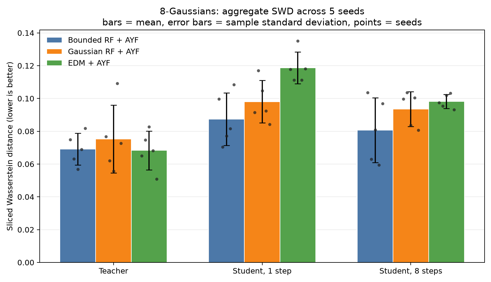
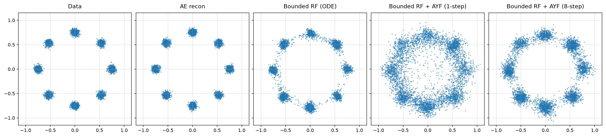

# UniFlow

UniFlow is a small research benchmark for one question: **does matching a
uniform base distribution to tanh-bounded latents improve rectified flow (RF)
and its few-step distillation compared with the usual Gaussian setup?**

The repository compares three matched toy pipelines:

| Arm | Data latent | Base distribution | Learned models |
|---|---|---|---|
| Gaussian RF | Unbounded encoder output | $\mathcal N(0, 0.5^2 I)$ | RF teacher + AYF student |
| Bounded RF | $\tanh(E(x)) \in (-1,1)^d$ | $\mathcal U([-1,1]^d)$ | RF teacher + AYF student |
| EDM | Unbounded encoder output | Gaussian perturbations | EDM teacher + AYF student |

This is intentionally a controlled 2D benchmark. The autoencoder and network
width/depth are matched across all arms. Gaussian RF and EDM use the same
unbounded encoder; the bounded-RF intervention changes the prior and adds the
encoder's final `tanh` together.

## Method

For both RF arms, independently sampled endpoints are joined by

$$
z_t = (1-t)z_0 + t z_1, \qquad t \sim \mathcal U(0,1),
$$

and the teacher regresses the conditional velocity with

$$
\mathcal L_{\mathrm{RF}}
= \mathbb E\left[\left\|v_\phi(z_t,t)-(z_1-z_0)\right\|^2\right].
$$

The AYF student is an arbitrary-interval flow map,

$$
C_\theta(z,t,s)=z+(s-t)f_\theta(z,t,s),
$$

trained to remain constant when its source moves along a teacher trajectory:

$$
\mathcal L_{\mathrm{AYF}}
= \mathbb E\left[\left\|
\partial_t C_\theta + J_z C_\theta\,v_\phi
\right\|^2\right].
$$

At inference, the same map supports one-step generation with $C(z_0,0,1)$ or
few-step generation by composing adjacent intervals. The EDM teacher retains
its standard preconditioned denoising objective. Its AYF student uses normalized
noise-to-data time and follows the EDM probability-flow velocity

$$
v_{\mathrm{EDM}}(z,t)
= \frac{d\log\sigma(t)}{dt}\left[z-D_\phi(z,\sigma(t))\right].
$$

This gives all three students the same arbitrary-interval boundary
$C_\theta(z,t,t)=z$ and the same deterministic interval-composition semantics.

## Results

> **Note:** The checked-in results below predate both the EDM encoder alignment
> and the EDM AYF student. They were generated with tanh-bounded EDM latents and
> an endpoint consistency student. The EDM row and figure must be regenerated
> before comparing them with results from the current code.

The default 8-Gaussians benchmark uses seeds 1–5, 32-dimensional latents, 20k
AE steps, 10k teacher steps, 10k student steps, and batch size 64. Each seed
evaluates 5,000 generated samples using sliced Wasserstein distance (SWD) in
data space over 256 fixed random projections; lower is better. Results are the
mean ± sample standard deviation across seeds. Figures use seed 1 as a
qualitative example and contain the target data, AE reconstruction, teacher ODE
samples, and one- and eight-step students.

<!-- BENCHMARK_RESULTS_START -->
| Pipeline | Teacher | Student, 1 step | Student, 8 steps |
|---|---:|---:|---:|
| Gaussian RF + AYF | 0.075 ± 0.021 | 0.098 ± 0.013 | 0.094 ± 0.011 |
| Bounded RF + AYF | 0.069 ± 0.010 | 0.087 ± 0.016 | 0.081 ± 0.020 |
| EDM + consistency student | 0.074 ± 0.020 | 0.084 ± 0.013 | 0.114 ± 0.028 |
<!-- BENCHMARK_RESULTS_END -->

Bounded RF has the lowest observed mean teacher and eight-step SWD, while EDM
has the lowest one-step mean. Compared with Gaussian RF, the bounded arm has
lower observed means at all three reported outputs. Interval composition
improves both RF students on average, while EDM refinement degrades its student.
The standard deviations overlap, so these are descriptive five-seed results,
not a significance test or a large-scale generative-model claim.

### Aggregate comparison

Bars show mean SWD, error bars show ± one sample standard deviation, and points
show the five individual seed results.



### Qualitative samples

The following panels are seed 1 examples from that archived benchmark run.

**Gaussian RF + AYF**


**Uniform noise + tanh-bounded RF + AYF**



**EDM**


## Reproduce

Python 3.10 or newer is required.

```bash
python -m venv .venv
source .venv/bin/activate
pip install -r requirements.txt
python -m toy.run_all
```

The default command reruns the five-seed benchmark while keeping seed 1 as the
only qualitative figure. Its new `edm_ayf_*` outputs are deliberately separate
from the archived `edm_*` consistency-student outputs shown above. When CUDA is
available, the seed runs execute in parallel spawned processes; each worker
runs the three pipelines for its seed sequentially. By default, one worker is
used per seed. Limit GPU memory use with `--workers N`, or pass `--workers 1`
for sequential execution. CPU runs remain sequential.

To continue an interrupted run, reuse completed seed files with:

```bash
python -m toy.run_all --resume
```

Raw per-seed metrics are written to `results/seeds/`; the aggregate, including
all individual values and the sample standard deviation, is written to
`results/summary_8gaussians.json` and a Markdown table is written to
`results/summary_8gaussians.md`. A corresponding grouped bar chart with
per-seed points and sample-standard-deviation error bars is written to
`results/summary_8gaussians.png`. `--resume` reuses completed seed files.

To generate qualitative figures for every seed, rerun with:

```bash
python -m toy.run_all --plot-all-seeds
```

This writes filenames such as `gaussian_rf_8gaussians-seed-3.png`. Because the
toy benchmark does not save model checkpoints, `--resume` cannot generate a
missing figure from an already completed run.

For a quick pipeline check:

```bash
python -m toy.run_all --seed 1 --ae_steps 10 --teacher_steps 10 --student_steps 10
```

Individual arms can be run with `python -m toy.gaussian_rf`,
`python -m toy.bounded_rf`, or `python -m toy.edm_baseline`.
All generated figures and JSON metrics are written to `results/`.

The `mnist/` directory contains optional bounded-RF/AYF and EDM extensions.
They are not part of the reported comparison and require `torchvision` plus a
separate, substantially longer training run.

## Repository layout

```text
core/rf/       shared RF teacher and ODE utilities
core/ayf/      Gaussian-prior AYF objective and sampling
core/ayf_rf/   uniform-prior, bounded-latent AYF objective and sampling
core/edm/      EDM teacher, AYF student, and consistency reference
toy/           primary 2D benchmark and runner
mnist/         optional image-space extension
results/       generated figures and metric summaries
```

## Scope

This repository contains research code, not a production library. The removed
ImageNet prototype was never validated and is deliberately excluded from the
public release. Large datasets, checkpoints, and local runs are ignored by Git.
