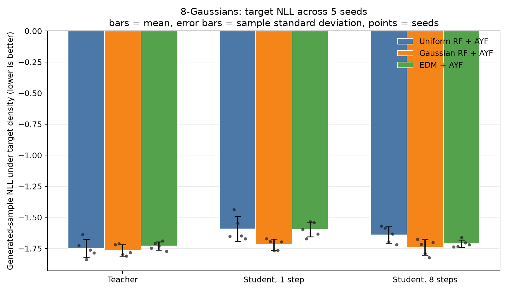

# 8-Gaussians benchmark results

Aggregated over **5 seeds** (1, 2, 3, 4, 5). Values are mean ± sample
standard deviation on 2,048 uniformly sampled points. Fidelity is
generated-sample NLL under the known target density; coverage is held-out target
NLL under a generated-sample KDE. Off-support is the fraction farther than three
target noise scales (0.105) from clean support.
All metrics are lower-is-better and should be interpreted together.

## Teacher

| Pipeline | Fidelity: target NLL ↓ | Coverage: KDE NLL ↓ | Off support (>3σ) ↓ |
|---|---:|---:|---:|
| Uniform RF + AYF | -1.750 ± 0.074 | -1.589 ± 0.017 | 1.3% ± 0.5% |
| Gaussian RF + AYF | -1.765 ± 0.046 | -1.591 ± 0.023 | 1.4% ± 0.3% |
| EDM + AYF | -1.729 ± 0.032 | -1.588 ± 0.016 | 1.8% ± 0.5% |

## Student, 1 step

| Pipeline | Fidelity: target NLL ↓ | Coverage: KDE NLL ↓ | Off support (>3σ) ↓ |
|---|---:|---:|---:|
| Uniform RF + AYF | -1.592 ± 0.099 | -1.589 ± 0.026 | 2.5% ± 0.5% |
| Gaussian RF + AYF | -1.719 ± 0.045 | -1.619 ± 0.022 | 2.0% ± 0.2% |
| EDM + AYF | -1.596 ± 0.059 | -1.609 ± 0.018 | 2.8% ± 0.3% |

## Student, 8 steps

| Pipeline | Fidelity: target NLL ↓ | Coverage: KDE NLL ↓ | Off support (>3σ) ↓ |
|---|---:|---:|---:|
| Uniform RF + AYF | -1.641 ± 0.066 | -1.559 ± 0.016 | 1.6% ± 0.4% |
| Gaussian RF + AYF | -1.742 ± 0.063 | -1.590 ± 0.026 | 1.6% ± 0.3% |
| EDM + AYF | -1.712 ± 0.030 | -1.583 ± 0.021 | 1.8% ± 0.3% |

## AE reconstruction reference

The AE row provides a near-data calibration point for finite-sample and density-estimation effects.

| Pipeline | Fidelity: target NLL ↓ | Coverage: KDE NLL ↓ | Off support (>3σ) ↓ |
|---|---:|---:|---:|
| Uniform RF + AYF | -1.775 ± 0.027 | -1.594 ± 0.022 | 1.2% ± 0.1% |
| Gaussian RF + AYF | -1.774 ± 0.026 | -1.593 ± 0.022 | 1.2% ± 0.2% |
| EDM + AYF | -1.774 ± 0.026 | -1.593 ± 0.022 | 1.2% ± 0.2% |

## Aggregate comparison

Bars show means, error bars show ± one sample standard deviation, and points show individual seeds.

## Observations

- Teacher — Fidelity: target NLL: Gaussian RF + AYF; Coverage: KDE NLL: Gaussian RF + AYF; Off support (>3σ): Uniform RF + AYF.
- Student, 1 step — Fidelity: target NLL: Gaussian RF + AYF; Coverage: KDE NLL: Gaussian RF + AYF; Off support (>3σ): Gaussian RF + AYF.
- Student, 8 steps — Fidelity: target NLL: Gaussian RF + AYF; Coverage: KDE NLL: Gaussian RF + AYF; Off support (>3σ): Uniform RF + AYF.
- These five-seed results are descriptive; overlapping standard deviations should not be interpreted as statistically significant differences.

Raw aggregate and per-seed values: [`summary.json`](summary.json).
